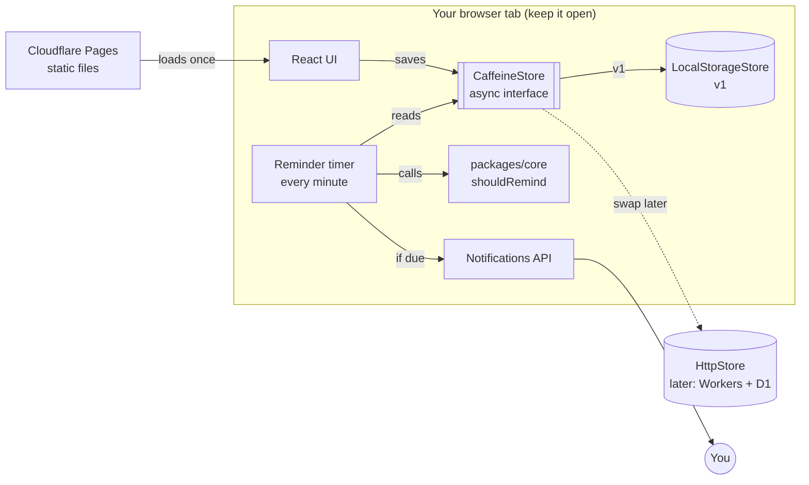

# Caffeine Tracker: architecture

Status: living copy for the build (Parts 2–4). The Part 1 original is frozen in
`../Part 1 - Architecture` at tag `part-1-architecture`.

## Changes since Part 1

- `listIntakes(from, to)` takes ISO instants, `from <= takenAt < to`, so callers
  work out day bounds in the user's time zone with `clockOnDay`. The interface
  also gained `updateIntake` and `removeCustomDrink`.
- `InMemoryStore` lives in `packages/core` and `LocalStorageStore` extends it,
  overriding one `persist()` method. That's the pattern for any future store.
- Caffeine logged on a work day before work starts still counts towards the
  daily limit (an early coffee is still caffeine).
- The gap mode measures from the latest of: start of work, the last drink, or the
  last reminder. So with no drink, reminders repeat once per gap.
- `nextReminderAt` is null once the limit is reached.
- Navigation uses hash routes (`#/today`, `#/calendar`, `#/settings`): no router dependency.
- The theme toggle in the header switches between light and dark and saves it;
  "system" is chosen in Settings.
- Notifications that aren't allowed fall back to an in-page banner.
- Part 4 (production): the pages are served with a strict Content Security
  Policy and other security headers from `apps/web/public/_headers`, so the
  theme-before-first-paint script moved out of `index.html` into
  `public/theme-init.js` (no inline scripts allowed). See section 11.
- Data from outside the running app (an imported backup, or what an earlier
  version left in localStorage) goes through `sanitizeStoreData` in
  `packages/core`: settings fall back field by field, malformed entries are
  dropped, and `takenAt` is normalised to UTC ISO. Both stores use it; the
  contract tests cover it.
- A React error boundary around the app shows a message and a reload button
  instead of a blank page. If the browser blocks site data entirely,
  `createStore` falls back to `InMemoryStore` for the session.

Visual version (Claude Design canvas): https://claude.ai/artifact/BTrzarsxNJSB65EYwf9kBz
The canvas and this document describe the same design. If you change one, update the other.
The canvas also has mock-ups of the two screens: Today (with drink search) and Settings.

## 1. Problem

I want to log my caffeine intake. If I haven't had caffeine for a while during my
work hours, the app should remind me.

This is a personal tool. It should cost nothing to run and have as few moving
parts as possible.

## 2. Requirements

### Functional
- **F1 Drink search:** search a built-in list of common drinks (coffee, espresso,
  tea, Coke Zero, Red Bull and so on) by name, with typo-tolerant matching. Each drink has a
  serving size and mg of caffeine. Results show your own drinks first.
- **F2 Your own drinks:** add a drink with a name, mg of caffeine and an optional
  serving size. You can edit or delete your own drinks.
- **F3 Log intake:** log a drink from search or from your drinks. Each entry
  copies the drink's name and mg at that moment, so editing a drink later
  doesn't change your history. The time of each entry can be edited.
- **F4 Today view:** total mg so far today against your limit, the time of the
  last drink, when the next reminder could fire, and today's entries.
- **F5 Work day:** choose a time zone (defaults to the one the browser detects),
  working days, a start time and an end time (default Mon–Fri, 09:00–17:00).
  All times are in the chosen time zone.
- **F6 Reminder mode:** pick one:
  - **Every few hours:** remind if there has been no caffeine for N hours (default 3).
  - **At set times:** a list of times (for example 10:00 and 13:30). At each time,
    remind only if there has been no caffeine since the time before it, or since
    the start of work. Times must fall within work hours.
- **F7 Guard rails, all set by the user:** never remind when
  - today's total is at or above the daily limit (default 400 mg, Health Canada's guideline for adults);
  - it's past the caffeine cut-off (default 15:00), to protect sleep;
  - the same gap or set time has already fired.
- **F8** Reminders work while the tab is open, including in the background.
  Settings have a "Send a test" button for notifications.
- **F9 Monthly calendar:** a separate screen (`./calendar` in the nav, next to
  `./today`) showing one month at a time, with previous and next buttons (no
  months after the current one). Each day has one of three colours:
  - no caffeine: the plain surface colour;
  - some caffeine, up to the limit: the accent (coffee) colour, showing the % of the daily limit;
  - over the limit: the warn (overflow) colour, showing the %.
  Future days are blank. Selecting a day shows its total and status. A side panel
  sums up the month: days with caffeine, days over the limit, the average on
  caffeine days, and the highest day. Each day is judged against the limit in
  settings when you view it.

### Non-functional
- Free to host. No server, database or accounts.
- Reminder rules are pure functions, so they're easy to test.
- Data stays on the device, in the browser.

### Known limits (accepted)
- No reminders when the tab is closed or the computer is asleep. When it wakes,
  the next check runs right away.
- Phones pause background tabs, so reminders on a phone are unreliable. Logging works fine.
- No sync between devices. Clearing browser data erases history.

### Out of scope for v1
- A backend, accounts, web push and sync. If reminders are ever needed with the
  tab closed, add Cloudflare Workers with a cron trigger and web push. The rules in
  `packages/core` can be reused as they are.

## 3. Key decisions

| # | Decision | Why | Alternatives considered |
|---|---|---|---|
| D1 | **Static web app** (React + Vite + TypeScript) | Builds to plain files that any static host serves | Native mobile app |
| D2 | **No backend** | Nothing to run, pay for or secure | Docker container (needs an always-on server, which costs money), Cloudflare Workers (more pieces than needed) |
| D3 | **Reminder timer in the open tab** (checks every 60 s, and again when the tab becomes visible) | Background tabs still run a once-a-minute timer | Server-side scheduler |
| D4 | **Browser Notifications API**, with an in-page banner as a fallback | Built in and free. The banner covers a denied permission | Web push (needs a server) |
| D5 | **Async `CaffeineStore` interface**, with `LocalStorageStore` for v1 | localStorage is simple and enough for one device. Everything else codes against the interface, so a database can replace it by adding one class (see section 5) | Calling localStorage directly; an in-browser fake HTTP API (same benefit, more code) |
| D6 | **npm workspaces:** `apps/web`, `packages/core` | The rules in `core` are tested on their own | Rules mixed into the UI code |
| D7 | **Testing:** Vitest (unit), Playwright (end to end, with a fake clock) | Fast, TypeScript native, Claude Code drives both well | Jest, Cypress |
| D8 | **Hosting:** Cloudflare Pages | Free, HTTPS, a `*.pages.dev` address, deploys from GitHub | Azure, Fly.io, Render |
| D9 | **Drink list bundled with the app** (`packages/core/src/drinks.json`), plus user drinks in localStorage | Works offline, free, instant search. Each entry records its source | Open Food Facts lookups (free, but caffeine data is patchy and needs a network) |
| D10 | **User-chosen IANA time zone, handled with the built-in `Intl` API** | No dependency. `Intl.supportedValuesOf("timeZone")` gives the picker its list | A date library such as date-fns-tz or Luxon |

## 4. System diagram



## 5. Storage interface

All reads and writes go through one interface, defined in `packages/core`.
Screens, hooks and the reminder timer only see this interface, never localStorage.

```ts
// packages/core/src/store.ts
export interface CaffeineStore {
  getSettings(): Promise<Settings>;
  saveSettings(s: Settings): Promise<void>;
  listIntakes(from: string, to: string): Promise<Intake[]>;   // ISO dates, inclusive
  addIntake(i: NewIntake): Promise<Intake>;
  updateIntake(i: Intake): Promise<void>;
  removeIntake(id: string): Promise<void>;
  listCustomDrinks(): Promise<CustomDrink[]>;
  saveCustomDrink(d: NewCustomDrink | CustomDrink): Promise<CustomDrink>;
  removeCustomDrink(id: string): Promise<void>;
  getLastReminder(): Promise<LastReminder | null>;
  setLastReminder(r: LastReminder): Promise<void>;
  exportAll(): Promise<ExportFile>;          // JSON backup, also used to move data
  importAll(f: ExportFile): Promise<void>;
}
```

| Implementation | Where | Used for |
|---|---|---|
| `LocalStorageStore` | `apps/web` | v1: the real app, data on this device |
| `InMemoryStore` | `packages/core` | Unit tests and Playwright tests that start empty |
| `HttpStore` (not built) | `apps/web` | Later: an external database, for example Cloudflare Workers + D1 |

Rules:
- **Async from day one.** localStorage is synchronous, but every method returns a
  Promise so a network-backed store drops in without touching any caller.
- **One place picks the store:** `apps/web/src/store/index.ts`, driven by
  `VITE_STORE` (`local` by default). Components get it from a `StoreProvider`
  and a `useStore()` hook.
- **The store saves and loads data and nothing else.** Rules such as daily totals,
  `shouldRemind` and drink search stay in `packages/core` and take plain data.
- **Contract tests:** one shared test suite (`packages/core/src/store.contract.ts`)
  runs against every implementation, so a future `HttpStore` must behave the same.
- **Errors:** methods reject with a `StoreError` (`"quota"`, `"unavailable"`,
  `"conflict"`), which the UI shows as a message rather than crashing.

Moving to an external database later also needs: sign-in, moving the existing
browser data (`exportAll` / `importAll`, exposed as "export / import" in Settings),
and, for reminders with the tab closed, moving the reminder check to the server.

## 6. Data model (LocalStorageStore, JSON)

Key `caffeine-tracker:v1` holds one object:

```ts
{
  settings: {
    timeZone: string;            // IANA, e.g. "America/Toronto"; default: browser's
    workDays: number[];          // 1 = Monday ... 7 = Sunday; default [1,2,3,4,5]
    workStart: "09:00";          // local time in timeZone
    workEnd: "17:00";
    reminder:
      | { mode: "gap"; gapMinutes: number }          // default 180
      | { mode: "times"; times: string[] };          // e.g. ["10:00", "13:30"]
    dailyLimitMg: 400;
    cutoffTime: "15:00";
    theme: "system" | "light" | "dark";   // default "system"
  };
  customDrinks: { id: string; name: string; mg: number; serving?: string }[];
  intakes: {
    id: string;
    drinkId?: string;            // built-in or custom drink, if any
    name: string;                // copied when logged
    mg: number;                  // copied when logged
    takenAt: string;             // ISO, UTC
  }[];
  lastReminder: { at: string; slot: string } | null;  // slot e.g. "2026-10-29T13:30"
}
```

Built-in drinks (`packages/core/src/drinks.json`):

```ts
{ id: string; name: string; aliases: string[]; serving: string; mg: number; source: string }
```

Example entries (to be checked against the source when the list is built):
Coke Zero 355 ml, 34 mg · Coca-Cola 355 ml, 34 mg · Diet Coke 355 ml, 46 mg ·
brewed coffee 240 ml, about 95 mg · espresso 30 ml, about 63 mg · black tea 240 ml, about 47 mg.

The version in the key (`v1`) lets us migrate the shape later.

`intakes` keeps every day, not just today, because the calendar needs past
months. Totals for each day are worked out from it in `packages/core`
(`dailyTotals(intakes, timeZone)`), grouping by the day in the user's time zone.
At one entry per drink this stays well within localStorage's limit for years.

## 7. Reminder rule (in `packages/core`)

```ts
shouldRemind({ now, settings, intakesToday, lastReminder }): {
  remind: boolean;
  slot?: string;   // which gap or set time this reminder is for
  reason: "outside-work-hours" | "past-cutoff" | "over-limit"
        | "not-due" | "already-reminded" | "due";
}

searchDrinks(query, builtIn, custom): Drink[]   // custom first, then best matches
```

Both are pure functions: no clock, storage or browser APIs inside, so every case
can be unit-tested. The timer in the web app loads the data, calls
`shouldRemind`, shows a notification when `remind` is true, and saves `lastReminder`.

Checks run in this order, and the first match wins: outside work hours or a day
off → past cut-off → at the daily limit → not due → already reminded for this
slot → due.

Edge cases the tests must cover: days off, start and end boundaries, the first
reminder of the day (no intake yet, measured from work start), set times outside
work hours, a set time missed while the computer was asleep (fire it late, until
the next set time or the end of work), a time zone other than the browser's,
daylight saving changes, the daily limit reached exactly, and search with typos
and mixed case.

## 8. Look and feel

A terminal-style ("hacker") theme with light and dark modes. The "Theme" board
on the canvas is the reference.

- Font: JetBrains Mono (Google Fonts) for everything.
- Terminal touches: `~$` prompts in headings, `// section` labels, `[ button ]`
  labels, and an ASCII progress bar for the daily total.
- Colours are CSS custom properties. Components use only the tokens, never raw hex:

| Token | Dark | Light |
|---|---|---|
| `--bg` | `#0B0F0C` | `#F4F6F1` |
| `--surface` | `#111812` | `#FFFFFF` |
| `--surface2` | `#16201A` | `#EAF0E8` |
| `--border` | `#24402C` | `#C9D3C6` |
| `--input` | `#4C8A5C` | `#6E8574` |
| `--text` | `#D7F5DD` | `#0E1A12` |
| `--muted` | `#86B394` | `#4A5E50` |
| `--accent` | `#39FF88` | `#0A7A3D` |
| `--on-accent` | `#04130A` | `#FFFFFF` |
| `--warn` | `#FFB000` | `#8A5200` |
| `--on-warn` | `#04130A` | `#FFFFFF` |

- **Coffee cup** (top of the Today screen; "Coffee cup" boards on the canvas):
  a pixel-style SVG cup, outlined in `--accent`, with scanlines over the liquid.
  - Fill level = today's total ÷ daily limit, capped at full.
  - Pixel steam rises in stepped animation whenever the total is above 0.
  - At the limit, the liquid turns `--warn`. Over the limit, it also spills over
    the rim, drips down the side and pools on the saucer, and the screen shows
    "over your daily limit by N mg".
  - Has an `aria-label` with the percentage, for screen readers. Animations stop
    when the user's system asks for reduced motion (`prefers-reduced-motion`).
  - Lives in `apps/web` as its own component, with props `mg`, `limit`, `theme`
    and `size` (`fixed` 240 px, or `fill`: grows with its column up to 520 px).
- Today screen layout (two columns, max width 1280 px):
  - **Left, two-thirds:** the coffee cup as the main visual, with the metrics below
    it: four tiles (total today, daily limit, last drink, next reminder), the
    ASCII progress bar, and the over-limit warning.
  - **Right, one-third:** a collapsible drawer with today's drinks
    ("history --today"), each with its time, mg and a remove button, under a
    `> brew --add` button.
    - The `»` button slides the drawer to the right (300 ms) and leaves a 56 px
      strip with a `+` (add a drink) button and a `«` button that shows the count.
      The cup then grows to fill the extra width (up to 720 px instead of 520 px).
    - `«` slides it back. Buttons use `aria-expanded`. The open or closed choice
      is remembered in localStorage (`settings.historyCollapsed`).
    - Animations are skipped when the system asks for reduced motion.
  - **Add-drink popup:** the button opens a modal dialog with drink search and
    the manual add form. Logging a drink, or "save + log", closes it and the drink
    appears in the history. "Save" keeps it open. Closes with ×, Esc or by
    clicking outside. Focus moves into the dialog when it opens and returns to the
    button when it closes.
  - On narrow screens the right column moves below the left.
- Theme setting: system (default, follows `prefers-color-scheme`), light or dark.
  Saved as `settings.theme` in localStorage, and applied before first paint so
  the page doesn't flash the wrong theme.
- Text meets WCAG AA contrast (4.5:1) in both modes. Touch targets are at least 44 px.

## 9. Demo mode

Adding `?demo=1` to the address sets the gap to 1 minute and checks every 10
seconds, so a reminder fires on stage.

## 10. Repo layout

```
caffeine-tracker/
  apps/
    web/        React + Vite app (Today, Calendar and Settings screens), reminder timer,
                store/ (LocalStorageStore, StoreProvider, useStore, store selection)
  packages/
    core/       Reminder rules, drink search, daily totals, drinks.json, shared types,
                CaffeineStore interface, InMemoryStore, store contract tests
  docs/
  .github/     CI workflow and Dependabot
  wrangler.toml, .node-version   Cloudflare Pages project and Node version
  CLAUDE.md
```

## 11. Production (Part 4)

Details in `docs/DEPLOYMENT.md`. In short:

- **CI** (`.github/workflows/ci.yml`): on every push and pull request, typecheck,
  unit and contract tests, Playwright end-to-end tests, production build and a
  production-dependency audit. On `main`, when the Cloudflare secrets are set,
  the tested build is deployed. Dependabot keeps dependencies and actions current.
- **Security headers** (`apps/web/public/_headers`, served by Cloudflare Pages and
  by `npm run preview`): a CSP that allows only same-origin scripts and no inline
  ones, no framing, `nosniff`, `no-referrer`, a restrictive Permissions-Policy,
  HSTS, and a one-year immutable cache for Vite's hashed assets. A unit test
  guards the policy and checks `index.html` against it.
- **Deploy** (D8): Cloudflare Pages, free, from GitHub either through the
  dashboard's Git integration or from the CI deploy job (`wrangler.toml`).
  Build command `npm run build`, output `apps/web/dist`, Node from `.node-version`.
